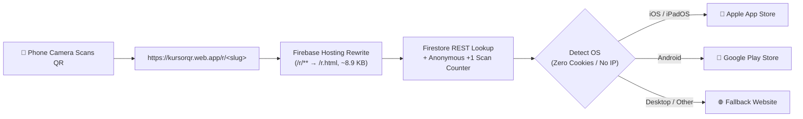

<div align="center">

  

  # KursorQR

  ### Dynamic QR Codes & Smart App Store / Google Play Redirection — Built for Zero Tracking

  **100% Free · 100% GDPR-Compliant · Zero Cookies · \$0/Month Spark Architecture · Open Source**

  <p align="center">
    <a href="https://kursorqr.web.app"></a>
    <a href="https://github.com/DimitrisMilios/KursorQR/releases/latest"></a>
    <a href="https://flutter.dev"></a>
    <a href="https://dart.dev"></a>
    <a href="#-under-the-hood-the-sub-9kb-redirector"></a>
    <a href="#-100-gdpr-compliant--zero-tracking"></a>
  </p>

  <p align="center">
    <b><a href="https://kursorqr.web.app">Launch Live App 🚀</a></b> •
    <b><a href="#-overview">Overview</a></b> •
    <b><a href="#-why-kursorqr">Why KursorQR</a></b> •
    <b><a href="#-key-features">Key Features</a></b> •
    <b><a href="#-local-development--deployment">Run Locally</a></b> •
    <b><a href="docs/CLAYMORPHISM_REDESIGN.md">Design & MVVM Guide 📖</a></b>
  </p>

</div>

---

## 🌟 Overview

**KursorQR** is a free, open-source, privacy-first **dynamic QR code and smart mobile app redirection platform** built with Clean MVVM Flutter Web and Firebase Spark.

It solves a common problem for mobile app developers, indie makers, and businesses: **printing or sharing a single QR code that automatically sends iOS users to the Apple App Store, Android users to Google Play, and desktop visitors to your website — while letting you update any destination anytime without reprinting.**

KursorQR runs two purpose-built engines under one unified domain (**`https://kursorqr.web.app`**):
- **`/`** — A tactile **Deep Rust & Pearl claymorphism** Flutter Web studio featuring an instant zero-account QR sandbox, multi-tenant link dashboard, and a high-resolution Branded QR Studio.
- **`/r/<slug>`** — A Firebase Hosting rewrite serving **`app/web/r.html` (< 9 KB vanilla HTML/JS)** that bypasses Flutter completely for near-instant mobile scans with **zero cookies, zero IP logging, and zero trackers**.

---

## ✨ Why KursorQR?

| Feature | KursorQR | Commercial QR SaaS (Bitly / QR Tiger / Flowcode) | Static QR Generators |
| :--- | :---: | :---: | :---: |
| **Smart OS Routing** | ⚡ **Auto-routes iOS, Android & Desktop** | 💳 Often gated behind paid tiers | ❌ Single fixed URL |
| **Dynamic Destination Editing** | ✅ **Edit anytime, never reprint** | 💳 Monthly subscription required | ❌ Immutable once printed |
| **Privacy & GDPR** | 🔒 **0 cookies, 0 IP logs, EU `eur3` DB** | 👁️ Cookies, fingerprinting & IP logs | ✅ No server tracking |
| **Redirect Latency** | 🚀 **< 9 KB vanilla HTML/JS (`/r/<slug>`)** | 🐢 Heavy tracking redirect chains | ✅ Direct |
| **Branded QR Studio** | 🎨 **Gradients, 16 icons, local logo upload, 2048px PNG** | 💳 Watermarked or paywalled | ⚠️ Basic black & white |
| **Hosting Cost** | 💸 **\$0/month on Firebase Spark Plan** | 💳 \$15–\$99+/month recurring | Free |
| **Source Code** | 📖 **100% Open Source (Clean MVVM)** | ❌ Closed SaaS | Varies |

---

## 🚀 Key Features

### 🔀 Smart Multi-Platform Routing (`/r/<slug>`)
- Point one permanent `/r/<slug>` link to separate **iOS App Store**, **Android Google Play**, and **Desktop / Fallback** URLs.
- Update any destination URL from your dashboard at any time — your printed posters, packaging, and business cards keep working instantly.
- Built-in lightweight redirect page (`app/web/r.html`) stays strictly under `15 KB` (enforced by CI, currently `~8.9 KB`) for fast redirects even on weak mobile data.

### 🎨 Branded QR Studio (`pretty_qr_code`)
- **Color & Gradients**: Solid fills or **2-color Linear Gradients** with 4 curated presets, custom hex inputs, and 4 gradient directions.
- **Module Geometry**: Choose between **Smooth**, **Dots**, and **Classic** QR module styles.
- **Center Emblems & Custom Logos**: Pick from **16 built-in vector icons** or upload your own **PNG / JPG / WebP logo** processed **100% in browser memory** (never uploaded to cloud storage).
- **Scan Safety Guardrails**: Automatic contrast warning when foreground/background contrast drops too low, plus automatic **Error Correction Level `H` (30%)** whenever a center icon or logo is active.
- **High-Res Lossless Export**: Save design presets per QR link and download crisp **512 × 512**, **1024 × 1024**, or **2048 × 2048 px** PNGs with one click.

### ⚡ Zero-Account Instant QR Sandbox
- Try KursorQR immediately on the landing page with zero sign-up required.
- Generate, style (gradients + icons), and download a branded QR PNG right in your browser.

### 🏺 Deep Rust & Pearl Claymorphism UI + Procedural 3D Assets
- Crafted with a custom tactile claymorphism widget kit (`#8B3103` Deep Rust & `#EAE0C8` Pearl), layered lighting depth, floating clay navigation bars, and spring/jelly press physics.
- Features **18 procedural 3D clay assets** rendered headless in **Blender 5.2 LTS** (`734 KB` total across PNG/WebP), completely reproducible from `tools/blender/render_clay_assets.py`.

### 🛡️ 100% GDPR-Compliant & Zero Tracking
- **For QR Scanners (`/r/<slug>`)**: **0 cookies, 0 `localStorage`, 0 IP logging, 0 PII.** Scans increment only anonymous aggregate counters (`totalScans`, `iosScans`, `androidScans`).
- **For Account Holders (`/`)**: Zero advertising or analytics cookies — only strictly necessary Firebase Auth session persistence when signed in, hosted in **EU `eur3` Cloud Firestore**.
- **Built-in User Rights**: Full in-app Privacy & Cookie Policy, **GDPR Art. 20 1-Click JSON Data Export**, and **GDPR Art. 17 1-Click Account & Data Erasure**.

### 💸 Engineered for \$0/Month on Firebase Spark Plan
- **Unbypassable Server-Side 10-QR Quota**: Enforced directly in [`firestore.rules`](firestore.rules) via atomic `WriteBatch` mutations on `users/{uid}.qrSlugs` — zero Cloud Functions required; deleting a link atomically frees a slot.
- **Anti-Spam Verification**: Google Sign-In works immediately (`email_verified == true`), while Email/Password accounts verify their inbox before creating links.
- **~90% Fewer Firestore Reads**: Uses on-demand `.get()` on login, optimistic local state mutations on Create/Edit/Delete, and a manual **Refresh Stats** control instead of draining persistent `snapshots()` listeners.
- **Immutable Web Asset Caching**: Build-time SHA-256 asset fingerprinting (`tools/fingerprint_web.mjs`) paired with `Cache-Control: immutable` headers in [`firebase.json`](firebase.json).

---

## ⚡ Under the Hood: The Sub-9KB Redirector



Because `/r/**` rewrites straight to `app/web/r.html`, mobile scanners **never download Flutter CanvasKit or the dashboard app** — delivering near-instant redirection while keeping hosting bandwidth minimal.

---

## 💻 Local Development & Deployment

### Prerequisites
- [Flutter SDK](https://docs.flutter.dev/get-started/install) (`>= 3.41.0`)
- [Dart SDK](https://dart.dev/get-dart) (`>= 3.6.0`)
- [Node.js](https://nodejs.org/) (`>= 20.0.0`) — for build fingerprinting & local production preview
- [Firebase CLI](https://firebase.google.com/docs/cli) (`npm i -g firebase-tools`) — for deploying Hosting & Firestore rules
- *(Optional)* [Blender 5.2 LTS](https://www.blender.org/) — only if regenerating the 3D clay assets

### 1. Clone the repository
```bash
git clone https://github.com/DimitrisMilios/KursorQR.git
cd KursorQR
```

### 2. Install Flutter dependencies
```bash
cd app
flutter pub get
```

### 3. Run in Chrome (Hot Reload)
```bash
flutter run -d chrome
```

### 4. Run static analysis & tests
```bash
flutter analyze
flutter test
```

### 5. Build production bundle, fingerprint & preview locally
```bash
flutter build web --release
cd ..
node tools/fingerprint_web.mjs
node tools/serve_web.mjs
```
Then open `http://localhost:8787` (supports both `/` and `/r/<slug>` rewrites just like Firebase Hosting).

### 6. Deploy to Firebase Hosting & Firestore Rules
```bash
firebase deploy --only hosting,firestore:rules
```

### 7. *(Optional)* Regenerate 3D Clay Assets in Blender 5.2
See [`tools/blender/README.md`](tools/blender/README.md) for the headless EEVEE render & WebP/PNG optimization pipeline.

---

## 🛠️ Architecture & Tech Stack

KursorQR follows a strict **Clean MVVM** architecture with `Provider`, granular `Selector` rebuild scoping, and repository/service isolation:

```text
KursorQR/
├── .github/workflows/
│   ├── ci.yml                          # Dev & PR checks (analyze, test, r.html <15KB guard, web build)
│   └── release-prod.yml                # SemVer bump, GitHub Release & Firebase Hosting + Rules deploy
├── docs/
│   └── CLAYMORPHISM_REDESIGN.md        # Full claymorphism tokens, motion, Blender & MVVM guide
├── tools/
│   ├── fingerprint_web.mjs             # SHA-256 content-hash fingerprinting for Flutter Web outputs
│   ├── serve_web.mjs                   # Local production preview server mirroring Firebase rewrites
│   └── blender/
│       ├── render_clay_assets.py       # Headless Blender 5.2 procedural 3D clay asset pipeline
│       ├── optimize_web_assets.py      # PNG/WebP web optimization & PWA icon generator
│       └── README.md
├── firebase.json                       # Unified Hosting rewrites (/r/** -> /r.html) & immutable cache headers
├── firestore.rules                     # Unbypassable 10-QR quota, email verification & anonymous +1 scan rules
├── firestore.indexes.json
└── app/                                # KursorQR Flutter Web App (Clean MVVM)
    ├── pubspec.yaml
    ├── assets/clay/                    # 18 optimized 3D claymorphism assets (734 KB total)
    ├── web/
    │   ├── index.html                  # Claymorphism HTML splash screen & font preconnects
    │   ├── manifest.json               # Deep Rust & Pearl PWA manifest
    │   └── r.html                      # ~8.9 KB vanilla HTML/JS GDPR redirect engine
    ├── lib/
    │   ├── main.dart                   # Entry point & Firebase initialization
    │   ├── app.dart                    # Composition root & MultiProvider dependency injection
    │   ├── core/
    │   │   ├── constants/              # Deep Rust & Pearl color palette, spacing & radii tokens
    │   │   ├── motion/                 # Spring physics, jelly transforms & staggered entrances
    │   │   ├── theme/                  # Nunito typography & clay theme tokens
    │   │   ├── app_config.dart         # Firebase Web client config & base domain
    │   │   └── qr_icon_catalog.dart    # 16 built-in vector QR center emblems
    │   ├── models/                     # QrLink, QrDesignConfig
    │   ├── repositories/               # AuthRepository, QrLinkRepository (atomic WriteBatch quota)
    │   ├── services/                   # QrRenderService (LRU badge cache), ClipboardService, FileDownloader, LocalImagePicker
    │   ├── viewmodels/                 # AuthViewModel, DashboardViewModel, QrStudioViewModel, LandingViewModel, Form ViewModels
    │   ├── views/
    │   │   ├── landing/                # Floating clay navbar, 3D hero, instant sandbox, features, GDPR banner
    │   │   ├── dashboard/              # Floating dashboard navbar, 3D KPI cards, quota meter, link cards
    │   │   ├── dialogs/                # Branded QR Studio, Auth, Link Form, Account Settings, GDPR Policy
    │   │   ├── verify_email_screen.dart
    │   │   └── firebase_error_screen.dart
    │   └── widgets/
    │       ├── clay/                   # Reusable claymorphism UI kit (buttons, cards, wells, dialogs, toasts, toggles)
    │       └── shared/                 # Ambient background, vector brand icons, brand logo, clay asset loader
    └── test/                           # MVVM ViewModel unit tests, clay widget tests & GDPR flow tests
```

---

## 🔄 CI/CD Pipeline

- **`dev` & Pull Requests** ([`.github/workflows/ci.yml`](.github/workflows/ci.yml)): Runs `flutter analyze`, `flutter test`, validates `app/web/r.html` inline JS syntax and enforces its strict `< 15 KB` size budget, builds the Flutter Web release bundle, and executes asset fingerprinting.
- **`main` Production Releases** ([`.github/workflows/release-prod.yml`](.github/workflows/release-prod.yml)): Parses Conventional Commits to bump SemVer in `app/pubspec.yaml`, tags & publishes a GitHub Release, and deploys both Hosting and `firestore.rules` to Firebase.

---

## 📖 Documentation

- **[Claymorphism Design System, MVVM & Optimization Guide](docs/CLAYMORPHISM_REDESIGN.md)** — Deep Rust & Pearl color tokens, spring physics, Clean MVVM contracts, and performance optimizations.
- **[Blender 3D Asset Pipeline Guide](tools/blender/README.md)** — How to reproduce and optimize all 18 3D clay icons and hero renders headless.

---

## 🤝 Contributing

Contributions, bug reports, and feature ideas are welcome!

1. **Fork the repository**
2. **Create a feature branch** from `dev` (`git checkout -b feat/your-feature`)
3. **Commit using Conventional Commits** (`feat:`, `fix:`, `docs:`, `refactor:`, `test:`)
4. **Verify analysis & tests** (`cd app && flutter analyze && flutter test`)
5. **Open a Pull Request** targeting `dev`

---

<div align="center">
  <sub>Built with care for privacy-conscious mobile developers & creators. If you find KursorQR useful, consider giving it a ⭐ on GitHub!</sub>
</div>
